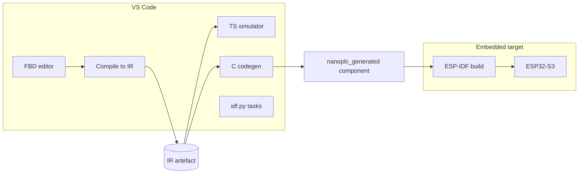

# Nano PLC plan: Virtual PLC, IDE, and firmware (ESP-IDF)

This document captures the target architecture and roadmap—from FBD/LAD editing to desktop simulation and ESP32 firmware under **ESP-IDF**. Update it as implementation evolves.

---

## 1. Product positioning

Goal: move from «block diagram editor» to a **lightweight PLC IDE**: one project, a single intermediate program representation, and a clear workflow **design → simulate on PC → build firmware → flash → debug hardware**.

UX reference for engineers: patterns like TIA Portal (live values, flow highlighting), SoftPLC/CODESYS (desktop runtime), Factory I/O (virtual plant)—within an **open toolchain** focused on ESP32.

---

## 2. End-to-end pipeline

```
FBD / LAD (optional ST)
        ↓
Intermediate AST / IR  ← single source of truth for simulator and codegen
        ↓
┌────────────────────────┐
│ Virtual PLC (PC)       │  simulation / debugging before hardware
│ inside VS Code         │
└────────────────────────┘
        ↓
C code generator
        ↓
ESP32 firmware (ESP-IDF)
```

### 2.1. Core simulator principle

**Do not emulate the ESP32 cycle-accurately**; emulate **the PLC execution model**:

- **tasks** (CODESYS Task Configuration: cyclic, freewheeling, event);
- deterministic **call order** of PROGRAM POUs inside each task;
- timers and variable memory;
- **process image I/O** (virtual inputs/outputs like a physical process).

This keeps maintenance simpler and reduces «simulator differs from silicon» drift—controlled by IR semantics and (later) shared runtime code.

---

## 3. VS Code extension modules (target shape)

| Module | Role |
|--------|------|
| Project tree (Device) | Hierarchy **device → modules → Task configuration → programs** akin to CODESYS (§3.2, §5) |
| FBD editor | Flow canvas **Node-RED–like** UX: blocks, wires, palette (§3.1) |
| LAD editor | Power rails / ladder (after FBD stabilizes; §22) |
| ST editor | Standard **text** VS Code surface + grammar/services; **not** a canvas (§3.1) |
| IR / AST layer | Graph normalization, checks, stable export format |
| Simulator (Virtual PLC) | Scan cycle, vars, timers, virtual I/O |
| Watch / live UI | Live values, highlight active flows (e.g. «green trace»); optional force |
| C codegen | IR → C + headers/tables for runtime |
| Build & flash | Invoke **ESP-IDF** (`idf.py build flash monitor`) from the workspace |
| Online debug (later) | Device ↔ IDE protocol (Serial / WebSocket, etc.) |

Existing foundation: `nanoplc-vscode` contributes **IEC ST/LAD/FBD grammars** and toolchain/bootstrap commands; **full IDE** scope (FBD canvas, device tree, simulator, codegen) remains per §11 / §49—**extend**, do not replace wholesale.

### 3.1. Editors by language type

- **FBD** — opening a user program (**Function Block Diagram**, FB-style POU files) uses a **dedicated flow editor** similar to [**Node-RED**](https://nodered.org/): pan/zoom canvas, drag blocks from a palette, **wire** outputs to inputs, per-block properties. Palette groups include I/O, logic, timers, math, bits, **Variables** (IN / IN_OUT / OUT / VAR / TEMP), and **Programs** (CALL other FBD POUs). This is **not** a plain syntax-highlighted `.fbd` text buffer without a WebView/React canvas.
- **ST (Structured Text)** — opening uses the normal VS Code **text** `TextEditor` plus IEC ST grammar, completions, diagnostics. No graph canvas.
- **LAD** — roadmap: dedicated graphic mode (rails, power flow). Until then: text highlighting only where applicable; no promise of a full PLC LAD editor before that ships.

`package.json`: register FBD via **`customEditor`**, `WebviewPanel`, or **virtual document** canvas; ST via the standard language contribution on text URIs.

### 3.2. Project tree: device, modules, tasks, programs

A dedicated NanoPLC **Tree View** («**Project**», activity bar), similar to **CODESYS** (primary) and **TIA Portal** (device/modules): the root is the **device** (logical controller / platform preset, e.g. ESP32-S3). Child nodes are **structured configuration**, not a raw file dump:

| Tree node | Meaning (example) | Opens / action |
|-----------|-------------------|----------------|
| **Device** | PLC project + board (`nanoplc.project.json`) | Expand hierarchy |
| **Device configuration** | Board, `idf_target` | `nanoplc.project.json` |
| **Modules** | Field I/O modules (GPIO, future racks) | — |
| ↳ Module | e.g. Onboard GPIO (digital) | `src/io-map.json` |
| **Drivers** | HAL / fieldbus stacks bound to modules | — |
| ↳ Driver | e.g. `nanoplc_hal` → module | Driver info dialog (v0) |
| **Communication** | Modbus, MQTT, online debug (later) | Placeholder until Phase 3+ |
| **Application → Task configuration** | PLC tasks; each runs **one** PROGRAM (§5) | Add / configure task |
| ↳ Task | e.g. MainTask (Cyclic · 10 ms · Prio 1) | Task properties wizard |
| ↳ ↳ Entry program | e.g. Main | Opens that POU’s editor |
| **Application → Programs** | POU definitions (FBD / ST / LAD) — scheduled by a task **or** invoked by FBD `CALL` | — |
| ↳ Program | e.g. Main (FBD) | **FBD Diagram** custom editor or ST text |
| **Firmware** | ESP-IDF tree path | Folder link |

Target hierarchy (ASCII):

```
Device (and_gate · esp32-s3)
├── Device configuration
├── Modules
│   └── Onboard GPIO (digital)  → io-map.json
├── Drivers
│   └── GPIO process image (nanoplc_hal)
├── Communication
│   └── (none yet)
├── Application
│   ├── Task configuration
│   │   └── MainTask (Cyclic · 10 ms · Prio 1)
│   │       └── Main
│   └── Programs
│       └── Main (FBD)          → FBD canvas editor
└── Firmware (ESP-IDF)
```

**Workflow (v0):** **Add device** → pick from **device catalog** (I/O counts pre-filled) → optional **Add module** / **Add driver** → edit **Main** under Programs → (optional) **Add program** (then CALL it from FBD or bind it to its own task) → (optional) **Add task** / **Call program from task**. Context **+** on group rows; click a task to configure type, interval, priority, watchdog.

- **Device catalog (v0):** [M5Stack StamPLC K141](https://shop.m5stack.com/products/m5stamp-plc-controller-with-m5stamps3) (8 DI / 4 relay via AW9523), generic ESP32-S3 GPIO template. **Module catalog (v0):** M5Stack **StamPLC IO** (3 DO, 2 AI, I2C 0x20–0x2F), **StamPLC AC** (1 AC relay, I2C 0x44). Stored in `device.catalog_id` / module `catalog_id`; `io-map.json` and `src/modules/*.json` generated from templates. Implementation: `packages/ir-schema/src/deviceCatalog.ts`, `moduleCatalog.ts`.
- **Per-project firmware tree (v0):** **Add device** scaffolds `firmware/` under the project from `nanoplc-vscode/firmware-template/` (synced from repo `firmware/` at extension compile). **Compile PLC program** auto-creates or **patches** an existing tree (e.g. IDF 5.3 `esp_task_wdt` → `esp_system`). Command **NanoPLC: Init firmware tree** for manual init.

- The tree **serializes into** `nanoplc.project.json` (`modules[]`, `drivers[]`, `tasks[]`, `programs[]`) and **mirrors** `src/` / `build/`—users work from the logical device root, not loose files.
- When `modules` / `drivers` are omitted on disk, the IDE shows **sensible defaults** (onboard GPIO + `nanoplc_hal`) via `resolveDeviceTree()` in `packages/ir-schema`.
- When `tasks[]` is omitted, the IDE **synthesizes MainTask** from legacy `scan.period_ms` and the first program (`resolveTaskConfiguration()`). Editing a task persists `tasks[]` and keeps `scan.period_ms` as a cache of the primary cyclic interval.
- Adding a «module» or «protocol» runs **templates** that create JSON entries and source files for version control as usual.

---

## 4. Runtime strategy: two phases

### 4.1. Phase A — MVP in JavaScript/TypeScript

- IR runs in an interpreter inside the extension (or a small Node sidecar).
- **Pros:** fast MVP, easy debugging, tight VS Code integration.
- **Cons:** behaviour can diverge from the MCU unless IR semantics are strict.

### 4.2. Phase B — shared C execution core

- One implementation for **desktop (x86/host)** and **ESP32 (Xtensa)**—a «mini-CODESYS» style core.
- **Pros:** best simulator/hardware parity, SoftPLC-class trust.
- **Cons:** build matrix, tests, possible host target outside `idf.py`.

**Practical path:** start with **phase A**; design IR and API boundaries so the engine can **swap to phase B** without rewriting the editor.

---

## 5. Execution model (CODESYS Task Configuration)

NanoPLC schedules work the **CODESYS** way: **a task runs one entry PROGRAM**. There are no Siemens OB numbers (`OB1`, `OB35`, …). A PROGRAM on disk does nothing until a task or another PROGRAM (`CALL` in FBD) invokes it.

### 5.1. Roles

| Artifact | Role |
|----------|------|
| **PROGRAM** (POU) | User logic (FBD / later ST, LAD). Edited under Application → Programs. |
| **Task** | Runtime scheduler: kind, interval, priority, watchdog, **exactly one entry PROGRAM**. |
| **FUNCTION / FB** | Called from programs, never from a task (library work, §33). |

**Several programs, two patterns:**

1. **One program per task.** Fast cycle → FastTask → `Fast_PRG`. Slow cycle → SlowTask → `Diag_PRG`. Each task has its own period and priority.
2. **PROGRAM calls PROGRAM** (FBD `CALL`). MainTask still runs only `Main`; `Main` may invoke helper PROGRAMS. Callees are not listed on the task.

A task must not list a stack of POUs. Extra programs get their own task, or are called from another PROGRAM (`CALL`). The same PROGRAM should be bound to **one** task (`NP-0115` if it appears in several). `NP-0116` if a task still has a legacy `pous[]` with more than one entry.

### 5.2. Task kinds

| Kind | CODESYS analog | Behavior |
|------|----------------|----------|
| `cyclic` | Cyclic | Run every `interval_ms` using delay-until (not a busy loop). Default for MainTask. |
| `freewheeling` | Freewheeling | After a pass finishes, start the next as soon as the scheduler allows (minimum 1 RTOS tick). No interval. |
| `event` | Event | Rising edge of a BOOL `event` symbol. **Persisted in the IDE; runtime later (§33 T3).** |

Not in v0: Status tasks, external/interrupt tasks, Siemens-style hardware OBs.

### 5.3. Task properties

Stored on `nanoplc.project.json` → `tasks[]` (`NanoPlcTaskRef` in `packages/ir-schema`):

| Field | Meaning |
|-------|---------|
| `id` / `name` | Stable id + display name (default `main_task` / `MainTask`) |
| `kind` | `cyclic` \| `freewheeling` \| `event` |
| `priority` | **0 = highest**, 31 = lowest (CODESYS-like). Maps to a FreeRTOS priority band in firmware. |
| `interval_ms` | Required for `cyclic` |
| `event` | BOOL symbol for `event` tasks |
| `watchdog.enabled` / `watchdog.time_ms` | If a pass exceeds the timeout, log (v0) / fail-safe outputs (later) |
| `program` | Entry PROGRAM id. **Exactly one** per task. |

Legacy `pous[]` with a single `{ "program": "…" }` is still read; the IDE rewrites it to `program` on save.

### 5.4. Default and legacy projects

New **Add device** projects get one **MainTask**: cyclic, catalog `scan_period_ms` (typically 10 ms), priority 1, watchdog ≥ 5× interval, calling **Main**.

Legacy files with only `scan.period_ms` keep working: `resolveTaskConfiguration()` synthesizes MainTask from that period and `programs[0]`. Saving a task edit writes `tasks[]` and refreshes `scan.period_ms` as a **cache of the primary cyclic interval** so older IR/codegen (`scan_period_ms`) stay valid.

**Primary cyclic task** = MainTask by id/name, else the highest-priority (`priority` closest to 0) cyclic task.

### 5.5. I/O boundary (per task pass)

Typical PLC scan still applies **inside each task pass**: read process-image inputs → run the **entry PROGRAM** → write outputs.

Shared process image across tasks. v0 does not lock the PI between tasks; pin PLC tasks to one core when multiple FreeRTOS tasks exist (§7.3). Combinational cycles inside one FBD remain compile errors (`NP-0400`).

### 5.6. Timers

TON/TOF advance by **Δt of the task that executed them**, not a global tick:

- cyclic: nominal `interval_ms` (measured elapsed if overrun);
- freewheeling: measured elapsed of that pass;
- event: elapsed since previous run of that task (0 on first edge).

Document this in IR; keep TS simulator and C runtime on the same rule.

### 5.7. Runtime mapping (target)

Each PLC task becomes **one FreeRTOS task** (`np_<task id>`), high enough that Wi‑Fi/OTA cannot starve the fastest cyclic task.

| PLC kind | FreeRTOS pattern |
|----------|------------------|
| cyclic | `vTaskDelayUntil` with `interval_ms` |
| freewheeling | loop + `vTaskDelay(1)` (or yield) after each pass |
| event | wait on a notification / event bit set from the PI writer |

`app_main` must **not** hard-code `nanoplc_runtime_init(10)`. Codegen/runtime reads `tasks[]` (until then, primary cyclic interval).

Watchdog: register each PLC task with the ESP task WDT; log `task overrun` when elapsed > `interval_ms` (cyclic) or > `watchdog.time_ms`.

### 5.8. Simulator mapping (target)

One JS timer per **cyclic** task; freewheeling via queued microtasks with a yield; event tasks when the bound BOOL rises in the PI. v0 simulator still runs a **single** interval: the primary cyclic task’s `interval_ms`, executing that task’s entry PROGRAM (same limit as compile, §5.9).

### 5.9. Compile / codegen — current vs target

**Now (T0 + CALL):** compile and simulate the **entry PROGRAM** of the primary cyclic task, including FBD `CALL` into other PROGRAMS (`pou_schedules`). Extra **tasks** are stored and validated, with an explicit compile note. A task may bind only one program (`NP-0116`).

**Next (T1):** one FreeRTOS / simulator task per PLC task, each running its entry PROGRAM. IR `tasks[]` each with `kind`, interval/event, `priority`, and that program’s `schedule`.

**Then (T2):** event tasks, watchdog fail-safe.

**Later (T3 remainder):** FB libraries. PROGRAM-from-PROGRAM `CALL` in FBD is already in v0.

Drawn FBD **≠** execution order: topological compile inside a program still applies. Which program runs is the task’s `program` field, plus `CALL` boxes in that program.

### 5.10. PROGRAM variables and CALL ports (v0)

Each FBD PROGRAM may declare IEC-style sections on `src/*.fbd.json` → `variables[]`:

| Class | On the CALL box | Inside the callee |
|-------|-----------------|-------------------|
| **IN** | Input port | Read (`LOCAL` output `Q`) |
| **IN_OUT** | Input and output (same name) | Read/write |
| **OUT** | Output port | Write (`LOCAL` input `IN`) |
| **VAR** | Hidden | Static; persists between calls (PROGRAM is a singleton) |
| **TEMP** | Hidden | Reset to `initial` at the start of every call |

The FBD editor **Variables** list adds these declarations. Drag a name onto the canvas to place a `LOCAL` block. Dropping another program from **Programs** inserts `CALL` (`params.program`); ports update when the callee’s IN / IN_OUT / OUT list changes.

Compile copies IN / IN_OUT into the callee before its schedule (`call_in`), runs `pou_schedules`, then copies OUT / IN_OUT back (`call_out`). Shared process image (DI/DO/AI) is unchanged. Diagnostics: `NP-0216`…`NP-0219` (declarations / LOCAL), `NP-0410`…`NP-0413` (CALL).

---

## 6. What to simulate (order)

1. Digital I/O (buttons, coils, lamps). **Done (v0)** — `DI` / `DO` blocks, simulator panel, GPIO / AW9523 / StamPLC IO DO paths.
2. Standard timers (TON, TOF, pulse—per your block library). **Partial (v0)** — TON in IR + simulator; TOF/pulse todo.
3. Analog I/O vs analog **device stubs**. **Partial (v0)** — **`AI` block**, `read_ai` in schedule, simulator **AI** sliders/fields, StamPLC IO voltage read on device; **todo:** themed virtual transmitters (temperature, pressure, generic ADC profiles) as simulator widgets above raw REAL values.
4. Virtual devices (tank, motor, conveyor, valve)—layer above I/O («mini Factory I/O»).
5. Virtual fieldbuses (Modbus, MQTT, OPC UA—as needed to test SCADA without hardware).

---

## 7. Firmware build: ESP-IDF as source of truth

### 7.1. Why ESP-IDF first

- Official toolchain and releases for ESP32-S3.
- Straightforward loop: `idf.py build flash monitor`, `sdkconfig`, Kconfig.
- Reproducible on CI and for third-party devs.

Wrappers like PlatformIO may exist as **optional** paths for some users, but the **canonical** firmware tree remains native ESP-IDF in-repo.

### 7.2. Suggested repo layout (concept)

```
firmware/                          ← ESP-IDF app root
├── CMakeLists.txt
├── sdkconfig.defaults             ← pinned defaults for S3
├── main/
│   ├── CMakeLists.txt
│   └── app_main.c                 ← platform bring-up, PLC runtime hook
└── components/
    ├── nanoplc_runtime/           ← scan, timers, process image I/O, HAL hooks
    │   └── CMakeLists.txt
    └── nanoplc_generated/         ← codegen output (or firmware/generated/)
        └── CMakeLists.txt
```

- **`main`** — thin; do **not** hand-write FBD logic here.
- **`nanoplc_generated`** — generated files only; CMake lists **`SRCS` explicitly** (better for CI) or via an editor-produced list.
- Consider embedding **program / IR identity** (hash or build stamp) into build metadata.

### 7.3. FreeRTOS and networking

- **One FreeRTOS task per PLC task** (§5.7); Wi‑Fi, OTA, heavy TCP must not starve the highest-priority cyclic task.
- Prefer **Kconfig** toggles (WebSocket debug, Modbus TCP, OTA) so minimal firmware stays small.

### 7.4. VS Code integration

1. Recommend the official **Espressif ESP-IDF** extension for toolchain setup and `sdkconfig` ergonomics.
2. NanoPLC **Build / Flash / Monitor** commands invoke `idf.py ...` under the **project** `firmware_root` (fallback: workspace `nanoplc.firmwareRoot`) after user environment activation (**no hard-coded absolute IDF paths**—settings / Espressif compatibility).
3. **Compile PLC program** pipeline (v0): FBD → `build/ir.json` + `build/generated.manifest.json` → C codegen into `{firmware_root}/components/nanoplc_generated/` → optional **`idf.py set-target`** (from `device.idf_target`) + **`idf.py build`** when `nanoplc.buildFirmwareOnCompile` is true (default). Build runs in terminal **NanoPLC Build**; manifest records `device`, `codegen`, and `firmware` status.
4. Standalone user projects keep ESP-IDF under **`my-project/firmware/`**—run `idf.py` from that folder, not the PLC project root.

### 7.5. CI (when added)

- Pin ESP-IDF version.
- `idf.py set-target esp32s3` and `idf.py build` without flashing.
- Document IDF version and install steps next to the repo (script or Espressif doc link).

---

## 8. Aligning simulator and firmware

1. For a given IR program, maintain **golden scenarios**: after N scans, specific variable/output values are expected.
2. Run them in the TS simulator for regression; later, the same scenarios on C (host tests or shared core).

---

## 9. «Killer» user workflow

**Design → Simulate → Build (ESP-IDF) → Flash ESP32 → Online debug**

One project, one IR, predictable handoff from PC to silicon.

---

## 10. Risks and hardest parts

In similar systems, the hard problems are usually **not** a bare simulator, but:

- a stable **graph engine** (editing, persistence, performance);
- **UX** for live mode (smooth updates, no UI overload);
- **online-debug protocol & data model**.

Mitigate simulator/MCU mismatch: tight IR spec + tests + (later) shared C runtime.

---

## 11. Roadmap phases

### Phase 0 — Foundation

- [x] Lock **IR** format choice (**JSON** on disk — see `docs/IR_SCHEMA.md`).
- [x] Compile graph → **ordered step list** + cycle diagnostics (`packages/ir-schema`, **NanoPLC: Compile PLC program**).
- [ ] Minimal block set and variable types (partial: DI/DO/AND/OR/NOT/TON in compiler; semantics doc pending).

### Phase 1 — MVP «mini PLC IDE»

1. [ ] IDE structure: **Device/project tree** (§3.2); **FBD** Node-RED–style canvas (§3.1); **ST** plain VS Code editor (§3.1). **Done so far:** CODESYS-style **Project tree** (device → modules → drivers → application → **Task configuration** + programs); **FBD canvas v0**; ST/LAD grammar-only text—see §49.
2. [x] **JS/TS Virtual PLC** + **Run Simulation** (basic I/O panel, scan loop; flow highlighting todo).
3. [x] **C codegen** from IR → `firmware/components/nanoplc_generated/` (auto on compile; CLI `tools/codegen`).
4. [x] **ESP-IDF** skeleton under `firmware/` with working `idf.py build`; **manual** CLI flash/monitor. **Done:** NanoPLC IDE commands for Build/Flash/Monitor (§7.4); **per-project firmware scaffold** + **build on compile** (§7.4 item 3).
5. [x] **NanoPLC: Setup toolchain** flow installs pinned ESP-IDF via bundled bootstrap (`install.bat` / `install.sh`); settings keys §18 wired. Optional on Windows: command **NanoPLC: Add ESP-IDF export to PowerShell profile(s)** for `export.ps1`. **Todo:** gated first-build onboarding (§48) and coupling to the Espressif extension (§48.4).

_Current progress versus phases is summarized in §49._

### Phase 2 — Closer to metal

- [ ] Align timer / scan semantics with on-chip runtime.
- [ ] Online debug (simple transport + variable map).
- [ ] Migration plan to **shared C core** when parity demands it.

### Phase 3 — «Factory I/O lite»

- [ ] Virtual devices and I/O panels over the process image.

### Phase 4 — Virtual fieldbuses

- [ ] Virtual Modbus / MQTT / (optional) OPC UA in simulator for SCADA linkage.

---

## 12. ESP32-S3 platform fit

ESP32-S3 is capable enough for:

- PLC-like realtime scans with disciplined RTOS partitioning;
- WebSocket/USB/Serial debug channels;
- MQTT, Modbus, web HMI, OTA as later layers.

This supports the claim the stack can be **lightweight but not a toy**.

---

## 13. Monorepo layout (target)

Example future layout (names may evolve):

```
nanoplc/
├── docs/
│   └── VIRTUAL_PLC_PLAN.md
├── nanoplc-vscode/              ← VS Code extension (editor, simulator, tasks)
├── packages/
│   └── ir-schema/               ← IR schema, validator, TS types (optional)
├── tools/
│   └── codegen/                 ← C codegen CLI from IR
└── firmware/                    ← ESP-IDF app (see §7)
```

**In repo today:** `docs/`, `nanoplc-vscode/`, `firmware/`, `packages/ir-schema/` (incl. `deviceCatalog.ts`), `tools/codegen/`, and `examples/` match the skeleton above. Extension ships **`nanoplc-vscode/firmware-template/`** (synced from `firmware/` at compile) for per-project scaffold.

Rule: **`firmware/` must not depend on Node** during CI builds—only ESP-IDF and generated `*.c`/`*.h` committed or reproduced by codegen.

---

## 14. Next concrete commit: firmware bootstrap

Goal: blinky/empty PLC task + successful `idf.py build` for `esp32s3` **without** editor codegen yet.

Checklist:

1. [x] Create **`firmware/`** ESP-IDF project (root CMake + `main`).
2. [x] **`firmware/sdkconfig.defaults`** for ESP32-S3 (`CONFIG_IDF_TARGET="esp32s3"`, clocking, UART log, minimals).
3. [x] **`components/nanoplc_runtime/`** with `nanoplc_runtime_init` plus internal scan task calling stub `nanoplc_generated_program_scan`; WDT and scan overrun logging (see §41).
4. [x] **`components/nanoplc_generated/`** stub (`plc_program.c` placeholder matching §16).
5. [x] **`main/app_main.c`** — firmware boot hook calling `nanoplc_runtime_init`.
6. [x] Local verify: `idf.py set-target esp32s3`, `idf.py build` (maintainer workflow); flash + monitor optional. **Todo:** CI build job (§7.5).

Afterward, codegen replaces the stub body and expands `SRCS` in `nanoplc_generated`.

---

## 15. IR contract sketch (spec prep)

Until a serializer is chosen, record these **conceptual entities**:

| Entity | Role |
|--------|------|
| `project` | metadata, target MCU, tasks (kind/interval/priority/entry program); legacy `scan_period_ms` |
| `variables` | global/instance vars with types (BOOL, INT, REAL, …) and debug addressing |
| `io_image` | I/O mapping (symbolic name ↔ process-image index) |
| `network` | POU set / ladder rungs OR FBD blocks and wires |
| `instances` | FB instances (timers etc.) with parameters and variable refs |
| `schedule` | final **ordered** execution steps (compile output) |

Compatibility: **`ir_version`** integer/semver semantics—bump and migrate when meaning changes.

---

## 16. C codegen ↔ runtime contract

Split **fixed runtime** (never generated) vs **generated user logic**.

### 16.1. Stable names (example contract)

- `nanoplc_runtime_*` live in `nanoplc_runtime`, never generated.
- **v0 (until T2):** single user entry still used by the existing scan task:

  ```c
  void nanoplc_generated_program_scan(void);
  ```

  Body is the **entry PROGRAM** of the primary cyclic task. Period comes from that task (`nanoplc_runtime_scan_period_ms`), not a magic `10` in `app_main` (fix when T1 lands).

- **Target (T1):** one generated function per PLC task plus a static table:

  ```c
  void nanoplc_generated_task_main_task(uint32_t dt_ms);
  const nanoplc_TaskDesc *nanoplc_generated_tasks(size_t *out_count);
  ```

  `nanoplc_TaskDesc`: `id`, `kind`, `priority`, `interval_ms`, `watchdog_ms`, function pointer.

- Optional introspection / debug:

  ```c
  uint32_t nanoplc_generated_magic(void);           /* IR version / CRC */
  const nanoplc_VarMeta *nanoplc_generated_var_meta(size_t *out_count);
  ```

Define `nanoplc_VarMeta` once in `nanoplc_runtime` (`name`, `type`, offset or index).

### 16.2. Codegen

- Input: **validated IR**.
- Output: under `nanoplc_generated`: `plc_program.c`, `plc_program.h`, optional `SOURCES.lst` for CMake.

### 16.3. Timers

MVP suggestion: propagate **Δt of the executing task** (argument to the generated task function or runtime field) so TON/TOF advance deterministically per task pass—keeps parity with the TS simulator (§5.6).

---

## 17. Online debug phases

### Phase 1 — telemetry

Periodic snapshots: vars + critical I/O, **DEVICE → IDE** stream.

### Phase 2 — control

- Force/unforce a limited point set.
- Mirror commands on simulator ↔ hardware where feasible.

### Phase 3 — time sync & events

Scan indices or timestamps; optional «stop after N scans» gated to dev builds.

Transport (pick **one** for MVP): framed **UART/USB CDC** or **Wi‑Fi + WebSocket** behind Kconfig. Packet format: length-prefixed binary with CRC/CBOR/MessagePack; header carries protocol version + sequence.

Security: networked debug toggles off by default on shipping firmware; authenticate when enabled.

---

## 18. Workspace extension settings

Example keys (`nanoplc-vscode`, user or `.vscode/settings.json`):

| Key | Meaning |
|-----|---------|
| `nanoplc.firmwareRoot` | Relative path from workspace root to `firmware/` (fallback when project has no `firmware_root`) |
| `nanoplc.codegenOnCompile` | After compile, emit `plc_program.c` + `io_hal_config.c` into `nanoplc_generated` (default `true`) |
| `nanoplc.buildFirmwareOnCompile` | After codegen, run `idf.py set-target` + `idf.py build` for project device (default `true`) |
| `nanoplc-idf.idfSetupScript` | Path to `export.ps1` / `export.sh`, or omit if PATH already wired |
| `nanoplc-idf.python` | Optional IDF-managed Python interpreter |
| `nanoplc-idf.distRoot` | Toolchain install root (`~/.nanoplc`)—§48 |
| `nanoplc-idf.idfRelease` | Pinned Espressif tag—align §40 |
| `nanoplc-idf.buildTarget` | Default ESP-IDF target when project omits `device.idf_target` (e.g. `esp32s3`) |

Build/flash failures should log the active **`idf.py --version`** or env-derived IDF version line.

---

## 19. Testing

- Snapshots: **IR → JSON** fixtures for editor IR compiler regression.
- **Golden tests**: simulator harness (§8).
- Firmware **CI builds** without flash.
- Fuzz/debug-decode malformed packets once a debug protocol lands.

---

## 20. User project (workspace layout)

Unified **Nano PLC Project** markers (filename TBD):

```
my-line/
├── nanoplc.project.json          ← schema_version, board, scan, firmware_root, catalog_id
├── src/
│   ├── main.fbd.json             ← tie format to IR pipeline
│   └── io-map.json               ← optional symbolic pin map (from device catalog or manual)
├── build/
│   ├── ir.json                   ← compiled IR artefacts
│   └── generated.manifest.json   ← ir_sha256, device, codegen + firmware build stamps
└── firmware/                     ← per-project ESP-IDF app (scaffolded from extension template)
    ├── CMakeLists.txt
    ├── sdkconfig.defaults        ← includes CONFIG_IDF_TARGET="esp32s3"
    └── components/nanoplc_generated/  ← codegen output
```

- Separate **diagram sources** (diff-friendly JSON/binary + optional text peer) vs **derived IR from *Build PLC program***.
- On open: check `nanoplc.project.json.schema_version` and migrate (§21).
- **Device panel tree** (§3.2) edits the same conceptual objects as `nanoplc.project.json` + `src/`—avoid a stray «second» project root.

---

## 21. IR and project migrations

- Store transformation tables (`1 → 2`) in `packages/ir-schema` or the extension runtime.
- On mismatch: modal **backup-before-auto-patch**.
- Maintain backward compatibility for `examples/` (one-two minors) or explicit upgrade demos.

---

## 22. MVP editor languages & rollout order

UX requirements recap: **§3.1** (FBD canvas = Node-RED style; ST = plain text).

1. **FBD first**—natural DAG + IR wires + topo ordering.
2. **LAD second**—rungs, power rails, explicit internal order map into same IR with more work.

Concurrent POUs: **one entry PROGRAM per task**. Several programs → several tasks (different periods/priorities), **or** `CALL` from the entry program. T0 compile/runtime still execute the primary cyclic task’s entry PROGRAM (plus its CALLs); T1 runs every task (§5.9, §33).

---

## 23. Minimum block library (v0 spec)

Enough for drills + golden regressions:

| Block | Purpose |
|-------|---------|
| I/O coupling (BOOL / REAL) | map to process image via **module + channel** picker (`params.moduleId`, `params.channel`, `params.symbol`) and merged `io-map` |
| AND, OR, NOT | Boolean logic |
| CALL | Invoke another FBD PROGRAM; ports are the callee’s IN / IN_OUT / OUT |
| LOCAL | Read/write a program variable (IN, IN_OUT, OUT, VAR, TEMP) |
| CONST | Typed literal (`BOOL`, `INT`, `DINT`, `UINT`, `WORD`, `REAL`) |
| RS / SR latch (optional v0.1) | persistent state |
| TON, TOF | timers with PT/ET/Q |
| MOVE (INT/REAL) | when MVP exposes analog-ish consumers for CONST |
| INT GT/EQ compare | sequencing |

Document semantics in **`docs/BLOCK_SEMANTICS.md`**: evaluation order, PT=0 edge cases, cold-start behaviour.

---

## 24. Graph diagnostics / compile UX

Surface Problems entries:

- **Structural:** dangling wire, incompatible types (`NP-0305`), unresolved variable refs (`NP-0219`).
- **I/O binding:** DI/DO/AI missing binding (`NP-0214`), duplicate symbol (`NP-0213`); invalid CONST (`NP-0215`). Local channel numbers may repeat across modules; uniqueness is by **symbol** (process-image row).
- **Program interface:** invalid / duplicate variable (`NP-0216`…`NP-0218`); CALL self-call / cycle / missing target (`NP-0410`…`NP-0413`).
- **Ordering:** combinational-feedback cycles without deliberate trigger semantics—either forbid or insert implicit delay with warning (product rule).
- **Resource:** FB instance/IR size caps on low-end targets.

Stable codes (**`NP-xxxx`**) anchor docs; diagnostics link graph node IDs. **Build firmware** and **Compile** both run these checks (Build refuses `idf.py build` on failure).

---

## 25. Performance budgets

| Area | Guideline |
|------|-----------|
| Fastest cyclic task interval | Tunable (~10 ms); freewheeling must still yield so idle CPU is not pegged |
| IR + codegen on desktop | Roughly `<1 s` ~500-node graphs via background worker |
| Live simulator UI refresh | Batch 33–50 ms; push dirty subscriptions only |
| Debug transport | Avoid full snapshots of 10k vars every tick without subscription |

Log **max-scan-time** overrun via `esp_timer` when helpful.

---

## 26. Simulator replay

For QA reproducibility:

- Log virtual field inputs («operator trace»): time or scan index + I/O mutations.
- Re-run in TS simulator.
- Save `.nanoplc-replay.json` (binary optional).

MCU full replay unnecessary for MVP—same IR plus manual stimuli suffices early.

---

## 27. Security & product posture

- **Network debug OFF** default in releases; gated secrets/subnet allowances if temporarily ON.
- **OTA:** signed images once shipped; differentiate debug prod vs dev firmware bundles.
- **Online force indicators** mandatory; optionally auto-clear on disconnect / timeout.

---

## 28. Spin-off documents

| Doc | Topics |
|-----|--------|
| `docs/IR_SCHEMA.md` or JSON Schema | IR wire format + trivial sample |
| `docs/BLOCK_SEMANTICS.md` | MVP IEC-like interpretations |
| `docs/DEBUG_PROTOCOL.md` | Framing/versioning/handshake samples |
| `docs/TROUBLESHOOTING.md` | Expanded §44 |
| `docs/BOOTSTRAP_TOOLCHAIN.md` | ESP-IDF bootstrap variants (offline/proxy/rollback) |
| `docs/CONTRIBUTING.md` | build extension + firmware locally |

Keep `VIRTUAL_PLC_PLAN.md` roadmap-level—link outward for detail.

---

## 29. Version matrix

| Artefact | Source | Meaning |
|---------|--------|---------|
| `extension_version` | `nanoplc-vscode/package.json` | VS Code SemVer |
| `project.schema_version` | `nanoplc.project.json` | On-disk project/diagram packaging |
| `ir_version` | IR header fields | Semantic meaning of intermediate representation |
| `runtime_abi_version` | Const in `nanoplc_runtime` + codegen coupling | Stability of generated entrypoints |
| `codegen_cli_version` | `--version`, `generated.manifest.json` | Tool that emitted firmware C |

Bump **runtime ABI**: firmware image and generated sources must advance **together**; IDE may compare manifest versus local CLI and prompt regenerate.

---

## 30. Hardware I/O abstraction

- **`io-map.json`** maps IR symbols (`DI_Start`, `DO_Lamp`) to board pins (GPIO port/pin, active level, pulls).
- Implement **`nanoplc_hal`** (inside runtime or sibling component):

  - `hal_read_di(index)` / `hal_write_do(index)` drive hardware tables compiled or loaded at boot;
  - the desktop simulator swaps in a **pure software** process image sharing the **same indexes**.

Digital-only MVP; analog ADC/PWM after BOOL path stabilizes (`BLOCK_SEMANTICS` captures limits).

Treat **ESP32-S3** as reference hardware; alternate MCUs arrive via presets and CI matrices later.

---

## 31. Naming conventions

| Context | Guideline |
|---------|-----------|
| Diagram node/wire IDs | Stable UUID or `nk_<ulid>` unaffected by captions |
| IR variable identifiers | PLC-style ALL CAPS optional; restrict to `[A-Za-z0-9_]` namespaces |
| Generated C identifiers | ASCII-sanitized only; prefix `npgen_` internal static helpers |
| User diagnostics | Stable `NP-xxxx` codes (section 24) |

---

## 32. Git policy

Possible `.gitignore` trade-offs:

- Commit IDE `build/` IR artefacts or regenerate every time (*developer convenience* versus support reproducibility bundles).
- Always ignore firmware `CMakeCache.txt`, ESP-IDF `build/`, `sdkconfig.old`, etc.
- Ignore transient simulator dumps except checked-in `.nanoplc-replay` QA fixtures.

Template READMEs must state which artefacts belong in reproducible bundles.

---

## 33. Task runtime, multi-program compile, and libraries

Section 5 is the **product contract**. This section is the **implementation sequence**.

### 33.1. T0 — IDE Task Configuration (current)

- [x] `tasks[]` on `nanoplc.project.json` (`NanoPlcTaskRef`).
- [x] Project tree: Application → **Task configuration** → task → **one** entry PROGRAM.
- [x] Commands: add / configure / delete task; assign / remove program (replace, not a call list).
- [x] Default MainTask on **Add device**; legacy projects synthesize MainTask from `scan`.
- [x] Validation `NP-0106`…`NP-0116` (including **one program per task**).
- [x] Compile/simulate **entry PROGRAM** of the primary cyclic task (not blindly `programs[0]`).

### 33.2. T1 — Multi-task runtime

1. IR entity `tasks[]`: each task has `kind`, `interval_ms` / `event`, `priority`, `program`, and that program’s `schedule`.
2. Codegen: `nanoplc_generated_task_<id>(dt_ms)` + `nanoplc_generated_tasks()` table (§16.1).
3. `nanoplc_runtime` creates one FreeRTOS task per PLC task (§5.7); stop hard-coding `nanoplc_runtime_init(10)` in `app_main`.
4. Simulator: one timer (or event hook) per PLC task; TON Δt is per-task.
5. Overrun / watchdog logs include **task id**.

### 33.3. T2 — Event tasks and watchdog fail-safe

1. Event tasks: rising edge of a BOOL in the process image (or a dedicated event bit).
2. Watchdog timeout → configurable fail-safe (hold last / force outputs OFF).

### 33.4. T3 — PROGRAM calls PROGRAM, libraries

1. **CAL / program-from-program (v0 done):** FBD palette **Programs** lists other FBD POUs. Dropping a block inserts `CALL` (`params.program`) with the callee’s IN / IN_OUT / OUT ports. PROGRAM `variables[]`: IN, IN_OUT, OUT, VAR, TEMP; canvas access is `LOCAL`. Compile emits `call` plus `call_in` / `call_out` and `pou_schedules`. The callee is a singleton (shared process image, one TON/RS instance; VAR persists; TEMP resets each call). Cycles and self-calls are errors (`NP-0410`, `NP-0411`). Missing/unknown callee: `NP-0412`, `NP-0413`. Codegen emits `npgen_pou_<id>()` with argument copies. Process-image arrays (`npgen_di` / `npgen_ai` / `npgen_do`) are omitted when unused.
2. **FB libraries** as reusable IR subgraphs (`fb_def` plus instances) — not started.
3. User packages keyed to compatible `ir_version` branches.

Status / external tasks stay out of scope until T2 is stable.

### 33.5. Out of scope (still)

Siemens OB numbering, IEC 61131-3 certification, preemptive locking of the whole process image between tasks.

---

## 34. `examples/` bundles

| Example | Behaviour |
|---------|-----------|
| `blink_fbd` | Blink driven by `TON` |
| `and_gate` | Dual inputs into output plus golden asserts |
| `debounce_rs` | RS latch once library ships |

Each packs diagram sources and `ir.json`; ship generated `*.c` only for offline demos—otherwise regenerate from docs or scripts.

---

## 35. Extension localization strategy

- Start from English `package.nls.json`; layer locales (`package.nls.ru.json`) on demand.
- Keep machine-readable codes **`NP-xxxx`** stable everywhere; localize human hints and deep-link docs independently.
- **Repository language:** treat **English** as the default authoring language for tracked source, `docs/`, README, UI strings shipped by this project, and meaningful code comments—unless the file path is intentionally a localized resource (`package.nls.*.json`, etc.).
- **`node_modules`:** do **not** translate or rewrite dependency trees for locale; bundled vendor localization (for example TypeScript `lib/*/diagnosticMessages.*.json`) is upstream-owned and excluded from NanoPLC wording policy.

---

## 36. Parity checklist before shipping

Golden IR programmes must behave the same:

| Check | TS simulator | MCU firmware |
|-------|---------------|---------------|
| Scan cadence versus timer deltas | deterministic tick clock | scheduler-bound |
| `schedule` traversal | honours ordered steps | codegen matches |
| TON extremes (PT=0, reset IN) | spec documented | MCU matches documented rules |
| Post-scan snapshots | asserts | MCU golden harness or emulator |

Mismatch blocks coordinated **IDE + codegen + firmware** releases unless recorded as deliberate platform caveat.

---

## 37. Autosave / undo roadmap

- Autosave diagram sources; optional checkpoints before heavyweight codegen/IR migrations.
- Later: **Revert to last compiled** resurrecting artefacts from `build/` if editable JSON corrupts.

---

## 38. Developer flow diagram



---

## 39. IEC disclaimers and safety stance

- FBD/LAD vocabulary may evoke IEC 61131-3 but **never promises formal conformance** absent explicit certification workstreams.
- Block behaviour lives under **`docs/BLOCK_SEMANTICS.md`** keyed to **`ir_version`**—gaps versus canonical IEC enumerated there.
- **Functional safety/SIL workloads** unsupported by default—users shoulder risk evaluations.

---

## 40. Toolchain support matrix

Update per release with `CONTRIBUTING`:

| Component | Policy |
|-----------|--------|
| VS Code | Last **two majors** stable (trim if constrained) |
| Node.js builder | LTS per `engines` in `package.json` |
| ESP-IDF | **Single pinned minor** per IDE milestone (example 5.3.x); changelog calls bumps |
| Python for `idf.py` | Follow Espressif guidance for pinned IDF |

User-facing troubleshooting should stress **«IDF version mismatch == top build breaker»**.

---

## 41. MCU resilience

- Document cold-start outputs before scan cycle one (normally `LOW`/`off` safest for driven pins).
- Register PLC scan work under ESP-IDF **task watchdog** plus fail-safe output policy toggles.
- Respect brownout resets; disclaim timing jitter on awful power rails without UPS.
- Dual-slot OTA rollback remains future backlog.

---

## 42. On-device logging conventions

- Base tag `nanoplc`; subtopics `scan`, `io`, `debug`.
- ERROR: watchdog/ABI conflicts; WARN: scan overrun; INFO sparse lifecycle logs; DEBUG only via `sdkconfig`.
- Thin logging over slow transports in production builds—reserve verbose tracing for experimental builds.

---

## 43. Feature-flag coupling

| Layer | Mechanism |
|-------|-----------|
| Firmware | `Kconfig` and `sdkconfig.defaults` knobs |
| VS Code extension | Namespaces such as `nanoplc.experimental.*` |
| IR / codegen | Mandatory **`ir_version` bump plus migrations** for semantic changes |

---

## 44. Troubleshooting primer (`docs/TROUBLESHOOTING.md`)

| Symptom | First check |
|---------|-------------|
| `idf.py` refuses to run | `%IDF_PATH%` / `$env:IDF_PATH`, compare with section 40 |
| Firmware blank screen after merges | Manifest `runtime_abi_version` mismatched headers |
| Simulator disagrees hardware | Section 36 checklist; verify `io-map` polarity |
| Live UI jitter | Lower redraw cadence/narrow subscribed nodes |
| Timers jittery | PCs tolerate OS jitter; MCU scan overrun detectors |

---

## 45. MVP non-goals

- PLC-quality ST authoring parity alongside FBD.
- SCADA-grade HMI builder (debug overlays only).
- Certified industrial cybersecurity program.
- One-click importer for proprietary PLC vendor exchange formats.

---

## 46. Third-party licences

- Maintain repo-level `NOTICE` / `THIRD_PARTY` bundles for npm artefacts and downloadable toolchains ahead of Marketplace reviews.
- Keep dual firmware/extension artefacts under coherent **SPDX** statements; reconcile incompatible combos before redistribution.

---

## 47. Industry analog references

Explain NanoPLC using parallels like **TIA Portal**, **CODESYS SoftPLC**, or **Factory I/O** yet clarify this project covers **open** design/sim/build cycles for ESP32—not regulated-field drop-in replacements.

---

## 48. Toolchain packaging (thin `.vsix` plus bootstrap assist)

### 48.1. Principles

- Post-install onboarding (command **NanoPLC: Setup ESP-IDF toolchain** or gated first-build prompt).
- With consent, bootstrap **pinned Espressif artefacts** plus toolchains directly into **user-profile directories**, not bundled inside VSIX bytes.
- Default locations tunable via **`nanoplc-idf.distRoot`** (aligned with section 18).

  | OS | Example root |
  |----|--------------|
  | Windows | `%USERPROFILE%\.nanoplc\` (+ `esp-idf`, cached tools) |
  | Linux | `~/.nanoplc/` |
  | macOS | Pick ONE convention versus `~/Library/Application Support/NanoPLC/toolchain` |

- Persist `IDF_PATH`, `export.*`, python interpreter, optional `TOOLS_PATH`.

### 48.2. Implementation knobs

- Windows path may favor official installers when Espressif recommends them.
- Cross-platform fallback: shallow git-tag checkout followed by `install.bat`/`install.sh` then `export.*` before invoking `idf.py`.
- Log progress/resume downloads/free-space prerequisite checks.

### 48.3. UX transparency checklist

| Area | Requirement |
|------|---------------|
| Time or download size | Multi-minute/multi-GB workloads require explicit disclosures |
| Enterprise networks | Manual proxy/custom CA escapes |
| Supply chain hygiene | Verified endpoints plus checksum attestations plus consent logging |
| Windows antivirus churn | Mention unpack slowdown mitigation inside `BOOTSTRAP_TOOLCHAIN.md` |
| Binary licences | Post-download artefacts documented in `NOTICE` |
| Version retention policy | Permit multiple IDF trees under dist root for downgrade safety |

### 48.4. Optional Espressif extension coupling

- Depend on **`espressif.esp-idf-extension`** to outsource bootstrap UX (less NanoPLC bespoke code yet shared branding quirks).
- Or fully custom wizard aligning strictly with NanoPLC versioning—more maintenance overhead.

Expert users bypass wizards entirely by pointing NanoPLC JSON settings at vendor-managed installs.

---

## 49. Implementation status (snapshot)

Rolling record of **what exists in-tree** versus this roadmap—update after meaningful merges.

_Last reviewed: 2026-08-16._

### Repository and documentation

| Item | Status |
|------|--------|
| Layout `docs/`, `nanoplc-vscode/`, `firmware/` | **Done** |
| Root `README.md`, `LICENSE`, `.gitignore`, `.gitattributes`, `.editorconfig` | **Done** |
| Git repository initialized on `main` | **Done** (`remote` target is organizational choice) |
| `docs/BOOTSTRAP_TOOLCHAIN.md` | **Done** |
| English authoring policy (`/.cursor/rules/`, §35) | **Done** |

### VS Code extension (`nanoplc-vscode/`)

| Item | Status |
|------|--------|
| ST / LAD / FBD language IDs, configuration, TextMate grammars | **Done** |
| Settings `nanoplc.*` and `nanoplc-idf.*` (§18) | **Done** |
| Command: **Setup ESP-IDF toolchain** (bundled `bootstrap-idf.ps1` / `.sh`) | **Done** |
| Command: **Check idf.py in PATH** | **Done** |
| Command: **Add ESP-IDF export to PowerShell profile(s)** (Windows) | **Done** |
| FBD graph editor / `customEditor` canvas | **Partial (v0)** — palette, pan/zoom, wiring, properties; **Variables** (IN / IN_OUT / OUT / VAR / TEMP) + **Programs** CALL; **DI/DO/AI** **module → channel** picker (per hardware module); **CONST** typed literals; toolbar **Compile** / **Build firmware**; green trace todo |
| Device / project tree (§3.2) | **Partial (v0)** — CODESYS-style hierarchy; **Task configuration** (one entry PROGRAM per task); **device catalog** + **module catalog** (StamPLC IO); Add device/module/driver/program/task |
| `packages/ir-schema` + `docs/IR_SCHEMA.md` | **Done** |
| Example `examples/and_gate` | **Done** |
| TS **Virtual PLC** simulator (`PlcSimulator`, Run/Stop + I/O panel) | **Done** (v0 — DI/DO/AI panel; no green-trace yet) |
| **C codegen** → `nanoplc_generated/plc_program.c` | **Done** (v0 schedule ops including `call` / `call_in` / `call_out`; omit unused DI/AI/DO arrays; auto on compile via `nanoplc.codegenOnCompile`) |
| **`nanoplc_hal`** GPIO + registered I2C readers/writers from codegen | **Done** (v0 digital I/O; AW9523 DI/DO, StamPLC IO DO/AI) |
| **Device catalog** + scaffold on **Add device** | **Done** (v0 — StamPLC K141, generic ESP32-S3 GPIO) |
| **Per-project `firmware/` scaffold** + template in VSIX | **Done** (`firmware-template/`, `scripts/sync-firmware-template.js`) |
| **Compile → codegen → `idf.py build`** (project-aware) | **Done** (v0 — compile validates I/O bindings; **Build firmware** compiles then always runs idf; setting `nanoplc.buildFirmwareOnCompile` for Compile-only path) |
| Command **Init firmware tree** | **Done** |
| Tasks: `idf.py build` / `flash` / `monitor` (project `firmware_root`) | **Done** |

### Firmware (`firmware/`)

| Item | Status |
|------|--------|
| ESP-IDF app + `main` + `nanoplc_runtime` + `nanoplc_generated` (§7.2, §14) | **Done** |
| `sdkconfig.defaults` for ESP32-S3 (`CONFIG_IDF_TARGET="esp32s3"`) | **Done** |
| `nanoplc_runtime` CMake: `esp_system` (IDF 5.3; replaces removed `esp_task_wdt` component) | **Done** |
| PLC scan FreeRTOS task, WDT, overrun logging, stub `nanoplc_generated_program_scan` | **Done** (single cyclic task; T1 = one FreeRTOS task per PLC task, §33) |
| Maintainer workflow `idf.py set-target esp32s3` + `idf.py build` | **Done** (see `firmware/README.md`) |
| **StamPLC AW9523 driver** (`m5_aw9523` — onboard 8 DI / 4 relay DO @ I2C 0x59) | **Done** |
| **StamPLC IO I2C driver** (`m5_stamplc_io` — expansion DO + analog voltage read) | **Done** |
| **StamPLC AC I2C driver** (`m5_stamplc_ac` — PI4IOE5V6408 @ 0x44, AC relay) | **Done** |
| CI `idf.py build` (§7.5) | **Todo** |

### Phase 0 / later phases

Unchanged: IR format lock, ordered graph compile, TS simulator, C codegen, online debug, virtual I/O—see §11.

---

## Document history

- Initial roadmap derived from Virtual PLC ideation; anchored canonical firmware under **ESP-IDF**.
- Added sections13-19: monorepo layout concepts, bootstrap firmware scaffolding, IR/C contracts, debugger phases, settings matrix, testing notes.
- Added sections20-28: structured user project blobs, migrations, editor sequencing priorities, MVP block catalogue, UX diagnostics/replay/security appendices plus satellite documentation map.
- Added sections29-38: versioning HAL blueprint, naming + git rationale, multitasking backlog, parity checklist + autosave ideas, refreshed ASCII-safe mermaid flow.
- Added sections39-47: IEC posture disclaimers, tooling support matrix, reliability/logging/feature-flag guidance, troubleshooting seed, intentional non-goals, licensing/competitive analog bullets.
- Landed **`firmware/` ESP-IDF project** scaffolding plus ignore rules tying back to bootstrap instructions.
- Added section48 toolchain packaging strategy plus authored `BOOTSTRAP_TOOLCHAIN.md`; documented `nanoplc-idf.*` prefs.
- Refined VS Code module blueprint (§3): TIA-inspired device explorer, layered FBD Node-RED editor expectations, ST text modality, clarified runtime section numbering.
- **Translated entire roadmap prose to English (2026 maintenance pass)** whilst preserving numbering and anchors.
- **§49 implementation snapshot** plus §11 / §14 checkmarks aligned to current repo (`firmware/` bootstrap shipped, extension grammars + toolchain commands; IDE build/flash and FBD canvas still open).
- Extension: **Build / Flash / Monitor / Set target / Diagnose** commands invoking `idf.py` under `nanoplc.firmwareRoot` with ESP-IDF export activation (§7.4, §49).
- **Phase 0:** JSON IR (`docs/IR_SCHEMA.md`), `packages/ir-schema` compiler, project scaffold + **Compile PLC program**, Device tree, `examples/and_gate`.
- **Phase 1 (partial):** `PlcSimulator` scan runtime + **Run simulation** webview for virtual DI/DO/AI (§6).
- **FBD editor v0:** `customEditor` for `*.fbd.json` — Node-RED–style canvas (palette, wires, layout); opens from Device tree program nodes.
- **FBD wiring UX pass:** drag-to-connect (mousedown port → drag → release on compatible port) alongside click output→input; inputs accept a single wire (new connection replaces old), outputs fan out freely; wire selection/deletion fixed (click + Delete/Backspace, double-click, or **Delete connection** in properties).
- **Project tree v0 (CODESYS-style):** device → configuration → modules → drivers → communication → application → **Task configuration** + programs; `modules[]` / `drivers[]` / `tasks[]` in `nanoplc.project.json`.
- **Task Configuration (T0, 2026-08-16):** CODESYS-like tasks (`cyclic` / `freewheeling` / `event`); **one entry PROGRAM per task**; extra programs → extra tasks or FBD `CALL` (§33 T3); compile/simulate the primary cyclic task’s program (plus CALLs); runtime multi-task is §33 T1.
- **FBD CALL (2026-08-16):** Programs palette lists other FBD POUs; compile `call` + `pou_schedules`; simulator and C codegen invoke the callee (`NP-0410`…`NP-0413`).
- **PROGRAM variables (2026-08-16):** FBD `variables[]` — IN, IN_OUT, OUT, VAR, TEMP; editor Variables list + `LOCAL` blocks; CALL boxes show IN / IN_OUT / OUT; `call_in` / `call_out` in IR, simulator, and codegen (§5.10, §33 T3).
- **Codegen unused I/O arrays (2026-08-16):** emit `npgen_di` / `npgen_ai` / `npgen_do` only when the IR process image has that kind (fixes `-Wunused-variable` on empty AI).
- **Device catalog (v0):** QuickPick on **Add device**; StamPLC K141 (8 DI / 4 DO) + generic ESP32-S3; `deviceCatalog.ts`, auto `io-map.json`.
- **Firmware per project (v0):** `firmware-template/` packaged in VSIX; scaffold on **Add device** / **Compile** / **Init firmware tree**; auto-patch legacy trees for IDF 5.3.
- **Compile pipeline (v0):** `build/ir.json` + expanded `generated.manifest.json` (`device`, `codegen`, `firmware`); optional `idf.py build` for `device.idf_target`.
- **FBD I/O + CONST + build gate:** DI/DO/AI module/channel binding; typed **CONST**; compile/`Build firmware` require I/O binding (`NP-0214`); editor toolbar Compile / Build firmware.
- **StamPLC firmware drivers:** `m5_aw9523` (onboard AW9523), `m5_stamplc_io` (expansion module I2C), `m5_stamplc_ac` (AC relay @ 0x44); codegen emits HAL init + DI/DO/AI hooks in `io_hal_config.c`.
- **FBD multi-module I/O picker:** module dropdown + local channel per block (avoids DO/AI collisions when expansion modules are added).
- **Analog I/O (v0 partial):** FBD **Analog In**, IR `read_ai`, simulator AI panel; themed temperature/pressure/ADC stubs remain future work (§6.3).
- **IDF 5.3 fix:** `nanoplc_runtime` requires `esp_system` instead of removed `esp_task_wdt` component; default target in `sdkconfig.defaults`.
